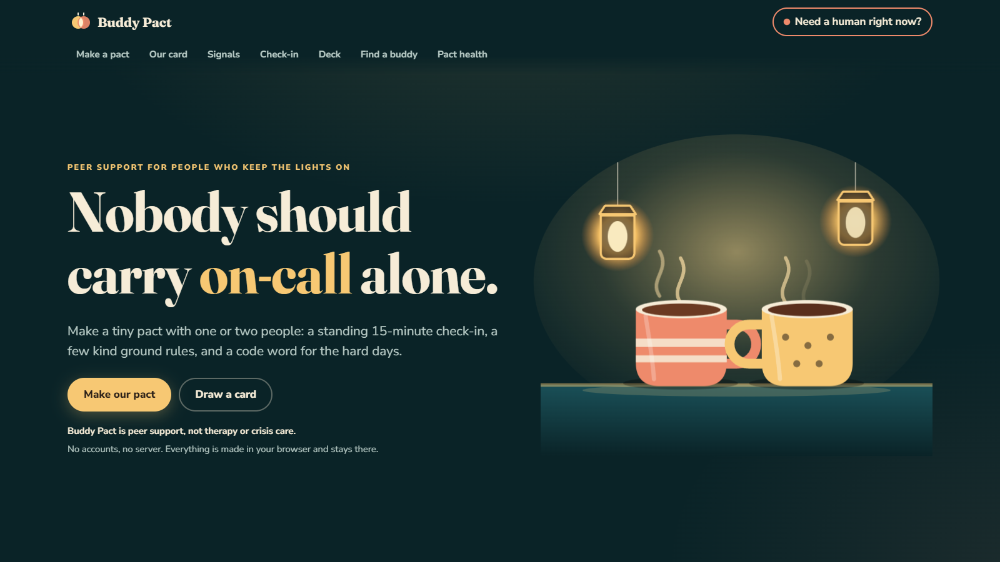
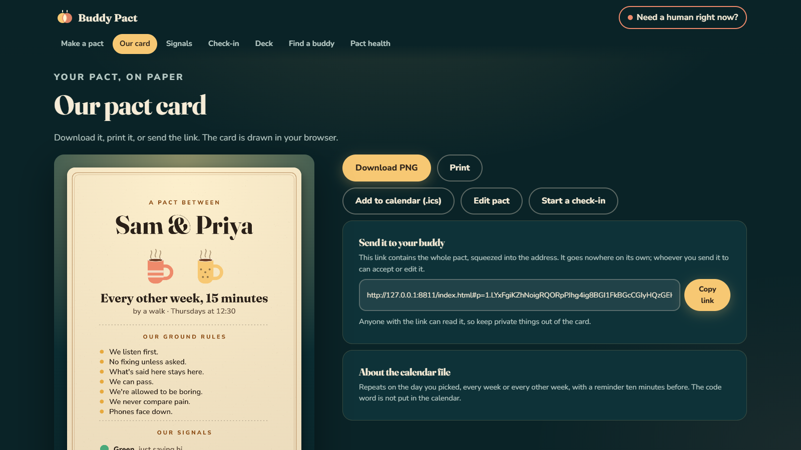

# BUDDY PACT

Nobody should carry on-call alone: a tiny, durable peer-support pact for two or three people, made in two minutes.

**[Live demo](https://tootenramen.github.io/Buddy-Pact/)**

## What you can do

- **Build a pact** in a short wizard: cadence, length, channel, ground rules, and a code word that means "I need you today."
- **Share it three ways**: a drawn pact card (PNG or print), a link that holds the whole pact in the URL hash, and a recurring `.ics` calendar file.
- **Use the signals**: green, amber and red messages ready to copy, plus a clear note that red means call a real person.
- **Run the check-in**: four short rounds (Uptime, Incidents, Patches, Commit) with a fair-share speaker timer, a pass button and an optional soft chime.
- **Draw from 60 cards** in four suits (Work, Body, Heart, Hope) with a light-to-deep slider and saved favourites.
- **Find a buddy** with kind scripts for asking, and for pausing or ending a pact; track how check-ins feel on a calm, local health page.

## How it works

One self-contained `index.html`. No accounts, no server, no analytics. The pact card is drawn on a canvas; the share link is JSON squeezed with a tiny pure-JS LZW compressor into the URL hash; the calendar file is built as valid iCalendar text. Your pact, log and saved cards live in this browser's localStorage and can be exported or deleted in one click. A persistent Help panel (988, findahelpline.com, local emergency number, doctor or EAP) and a crisis-language check on free-text fields keep safety one tap away. Buddy Pact is peer support, not therapy.

## Skills this shows

Product thinking and tone, accessible front-end (keyboard, reduced motion, responsive), canvas drawing, compression and encoding without libraries, WebAudio, and Playwright end-to-end testing.

Built by Gustavo Freitas - [LinkedIn](https://www.linkedin.com/in/gustavo-freitas-69b93910b/) - [more projects](https://github.com/Tootenramen)
